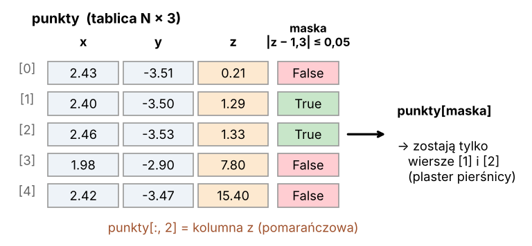

# Lekcja 2 – numpy: chmura punktów jako tablica liczb

**Czego się nauczysz:** czym jest tablica `numpy`, dlaczego chmura punktów to tablica
**N × 3**, jak wyciąć z niej kolumnę lub wiersz, jak liczyć min, max i średnią
oraz jak filtrować punkty **maską** (prawda / fałsz).

**Pliki:** `cwiczenie_02_numpy.py`, `rozwiazanie_02_numpy.py`

---

## Najpierw po leśnemu

Skaner TLS zapisuje miliony punktów. Każdy punkt to trzy liczby: **x, y, z** (metry).
Wyobraź sobie ogromny arkusz Excela: **jeden wiersz = jeden punkt**, trzy kolumny x, y, z.
15 milionów wierszy.

Zwykła lista Pythona z lekcji 1 by się zadyszała – musiałaby przechodzić punkt po punkcie.
**numpy** liczy na całych kolumnach naraz, jak harwester, który ścina, okrzesuje i tnie
w jednym ruchu, zamiast drwala z siekierą. Działanie na 15 mln punktów trwa ułamek sekundy.

**Maska** to jak kredą oznaczanie drzew do wycinki: dla każdego punktu stawiamy
„tak” albo „nie”, a potem jednym ruchem bierzemy tylko te z „tak”.



---

## Tablica N × 3

```python
import numpy as np

punkty = np.array([[2.43, -3.51,  0.21],
                   [2.40, -3.50,  1.29],
                   [2.46, -3.53,  1.33]])
print(punkty.shape)    # (3, 3) – 3 wiersze (punkty), 3 kolumny (x, y, z)
print(punkty.dtype)    # float64 – liczby z kropką, bardzo dokładne
```

Z trzech osobnych kolumn tablicę skleja `np.column_stack([x, y, z])` – zobaczysz to
w prawdziwym kodzie poniżej.

## Wycinanie (indeksowanie)

W nawiasie kwadratowym podajemy **[wiersze, kolumny]**. Dwukropek `:` znaczy „wszystkie”.

```python
punkty[0]        # pierwszy punkt (wiersz 0): [2.43, -3.51, 0.21]
punkty[0, 2]     # z pierwszego punktu: 0.21
punkty[:, 0]     # kolumna x WSZYSTKICH punktów
punkty[:, 2]     # kolumna z
punkty[:100]     # pierwsze 100 punktów
punkty[-1]       # ostatni punkt
```

## Statystyki – na całej kolumnie naraz

```python
z = punkty[:, 2]
z.min(), z.max(), z.mean()        # najniższy, najwyższy, średni
np.median(z)                      # mediana
np.percentile(z, 99.9)            # 99,9 percentyl (prawie najwyższy – bez szumu)
punkty.mean(axis=0)               # średnia KAŻDEJ kolumny -> [x_śr, y_śr, z_śr]
```

`axis=0` znaczy „licz w dół, wzdłuż wierszy” – czyli osobno dla każdej kolumny.

## Działania na całych kolumnach

```python
z_od_dolu = z - z.min()                 # od każdego z odejmij najniższe z
odl = np.sqrt((x - 10)**2 + (y - 20)**2)   # odległość KAŻDEGO punktu od (10, 20)
```

Żadnej pętli `for`! numpy robi to dla wszystkich punktów naraz.

## Maski – filtrowanie punktów

```python
maska = (z_od_dolu > 1.25) & (z_od_dolu < 1.35)   # True / False dla każdego punktu
plaster = punkty[maska]                            # tylko punkty z True
print(maska.sum())                                 # ile jest True (True liczy się jak 1)
print(maska.mean())                                # jaki to ułamek wszystkich
```

- `&` – „i” (oba warunki), `|` – „lub”, `~` – „nie” (odwraca maskę).
- **Nawiasy wokół każdego warunku są obowiązkowe:** `(a > 1) & (a < 2)`.
- W numpy **nie** używamy słów `and` / `or` – one działają tylko na pojedynczych wartościach.

---

## Prawdziwy kod LidarTreeSegmenter – linijka po linijce

**Fragment 1** – `program\10_pien_galezie_liscie.py`, wczytanie chmury:

```python
    xyz = np.column_stack([np.asarray(las.x), np.asarray(las.y),
                           np.asarray(las.z)])
    drzewo = np.asarray(las[pole_drzewa]).astype(np.int64)
```

| linia | co robi |
|---|---|
| `np.asarray(las.x)` | kolumna x z pliku zamieniona na tablicę numpy |
| `np.column_stack([... x, y, z ...])` | sklej trzy kolumny obok siebie → tablica N × 3 o nazwie `xyz` |
| `.astype(np.int64)` | zamień numery drzew na liczby całkowite (64-bitowe – zmieszczą każdy numer) |

**Fragment 2** – ten sam plik, rysowanie karty drzewa: wybór punktów plastra pierśnicy.

```python
        pl = wsz[np.abs(h[wsz] - 1.3) <= 0.05]
        dx = (xyz[pl, 0] - cx) * 100; dy = (xyz[pl, 1] - cy) * 100
```

| fragment | co robi |
|---|---|
| `wsz` | numery wszystkich punktów jednego drzewa |
| `h[wsz] - 1.3` | o ile każdy z nich jest powyżej / poniżej 1,3 m |
| `np.abs(...) <= 0.05` | **maska**: czy różnica jest najwyżej 5 cm (w górę lub w dół) |
| `wsz[maska]` | zostaw tylko punkty z plastra 1,25–1,35 m |
| `xyz[pl, 0] - cx` | x tych punktów minus środek pnia `cx` … |
| `* 100` | … w centymetrach. Wszystko na całych kolumnach, bez pętli. |

To dokładnie to, co robi nasze ćwiczenie – tylko że LidarTreeSegmenter robi to dla każdego drzewa.

---

## Uruchom rozwiązanie

Bez pliku – program sam robi sztuczny „pień” (walec o promieniu 20 cm):

```
python rozwiazanie_02_numpy.py
```

```
Nie podano pliku - używam sztucznego pnia (walec r = 20 cm).

Kształt tablicy: (5000, 3)  (wiersze = punkty, kolumny = x y z)
Typ liczb: float64
...
X: od 9.79 do 10.21 m
Z: od 0.00 do 6.00 m
Środek chmury (średnia x, y, z): [10.   20.    2.99]

W plastrze 1,25-1,35 m od dołu jest 83 punktów z 5000
Średnia odległość od środka plastra: 19.6 cm
  (dla sztucznego pnia powinno wyjść ok. 20 cm = promień)
```

Z prawdziwym skanem (przeciągnij plik do konsoli):

```
python rozwiazanie_02_numpy.py dane_testowe\SKAN_czesci_maly_2_-4.laz
```

> Na prawdziwym skanie „wysokość od najniższego punktu” to jeszcze nie wysokość nad
> gruntem – teren jest nierówny. Naprawimy to w lekcji 4.

---

## Ćwiczenie

W `cwiczenie_02_numpy.py`:

1. **TODO 1** – wytnij kolumny `y` i `z`.
2. **TODO 2** – wypisz zasięg (min i max) każdej kolumny.
3. **TODO 3** – policz środek chmury `punkty.mean(axis=0)`.
4. **TODO 4** – zrób maskę plastra 1,25–1,35 m od najniższego punktu i policz punkty.
5. **TODO 5 (dla chętnych)** – średnia odległość punktów plastra od jego środka.
   Dla sztucznego pnia ma wyjść ok. 20 cm.

## Podpowiedź

- Kolumna: `punkty[:, 1]`, `punkty[:, 2]`.
- Zasięg: `print(f"Z: od {z.min():.2f} do {z.max():.2f} m")` – `:.2f` to dwa miejsca po kropce.
- Odległość od środka plastra:
  `sx, sy = plaster[:, 0].mean(), plaster[:, 1].mean()`
  `odl = np.sqrt((plaster[:, 0] - sx)**2 + (plaster[:, 1] - sy)**2)`.
- Błąd `TypeError: unsupported operand ... NoneType` znaczy, że zmienna wciąż ma `None`
  (nie uzupełniłeś TODO 1).

## Podsumowanie

- chmura punktów = tablica `numpy` o kształcie **(N, 3)**,
- `punkty[:, 2]` – kolumna z; `punkty[i]` – punkt numer i,
- `.min() .max() .mean()`, `np.percentile(...)` liczą na całych kolumnach,
- **maska** `(warunek1) & (warunek2)` i `punkty[maska]` – filtr punktów bez pętli.
