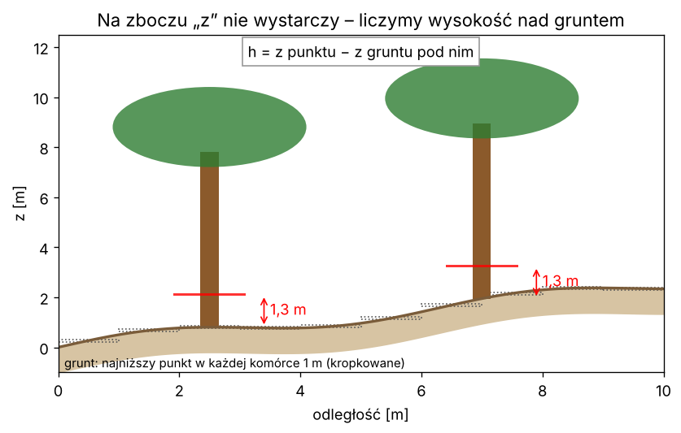

# Lekcja 4 – Wysokość nad gruntem i plaster na 1,3 m

**Czego się nauczysz:** jak zrobić prosty model terenu (grunt), policzyć wysokość
każdego punktu nad gruntem, wyciąć plaster pierśnicy 1,3 m ± 5 cm i zapisać go jako
nowy plik `.laz`.

**Pliki:** `cwiczenie_04_wysokosc.py`, `rozwiazanie_04_wysokosc.py`

---

## Najpierw po leśnemu

Pierśnicę mierzysz **1,3 m nad gruntem przy pniu**, a nie 1,3 m nad poziomem morza.
Na zboczu grunt pod jednym drzewem może być 3 m wyżej niż pod drugim. Współrzędna `z`
ze skanera to wysokość „bezwzględna” – sama w sobie nic nie mówi o drzewie.

Dlatego najpierw trzeba wiedzieć, **gdzie jest ziemia** pod każdym punktem.
Pomysł jest prosty jak tyczenie siatki na powierzchni:

1. podziel teren na kwadraty 1 × 1 m,
2. w każdym kwadracie **najniższy punkt to grunt** (skaner stoi na ziemi i widzi ją gęsto),
3. wysokość punktu nad gruntem = jego `z` minus `z` gruntu w jego kwadracie.



Po tym kroku grunt leży na wysokości 0 i wszystko staje się proste:
„plaster pierśnicy” to punkty, których wysokość jest blisko 1,3 m.

---

## Nowe narzędzia

```python
kol = ((x - x.min()) / 1.0).astype(np.int64)    # numer kolumny kwadratu (0, 1, 2 ...)
```

`(x - x.min())` – odległość od lewej krawędzi; dzielenie przez bok kwadratu i obcięcie
części ułamkowej (`astype(int)`) daje numer kwadratu. Punkt w x = 3,7 m od krawędzi
leży w kwadracie numer 3.

```python
siatka = np.full((n_wierszy, n_kolumn), np.inf)   # tablica 2D wypełniona "nieskończonością"
np.minimum.at(siatka, (wie, kol), z)               # w każdej kratce zostaw najmniejsze z
```

`np.minimum.at` – „dla każdego punktu: wpisz jego `z` do jego kratki, jeśli jest mniejsze
od tego, co już tam jest”. Bez żadnej pętli. Na starcie jest `inf` (nieskończoność),
więc pierwszy punkt zawsze wygrywa.

```python
grunt_pod_punktem = siatka[wie, kol]   # dla każdego punktu odczytaj grunt z jego kratki
h = z - grunt_pod_punktem
```

### Filtry wysokości – same maski z lekcji 2

```python
grunt   = h < 0.10                     # do 10 cm – ziemia
plaster = np.abs(h - 1.3) <= 0.05      # 1,25–1,35 m – pierśnica
korona  = h >= 2.0
```

### Zapis wybranych punktów do nowego pliku

```python
nowy = laspy.LasData(las.header)       # nowy "pusty operat" z tym samym nagłówkiem
nowy.points = las.points[plaster]      # tylko punkty z maski (z WSZYSTKIMI polami)
nowy.write("wyniki_kursu/plaster.laz")
```

Plik otworzysz w CloudCompare – zobaczysz z góry „kółka” pni. To jest właśnie to,
co LidarTreeSegmenter mierzy na pierśnicy.

---

## Prawdziwy kod LidarTreeSegmenter – linijka po linijce

Fragment z `tree_segmenter_tool\02_detect_trees.py`, krok 3 „model terenu” (LidarTreeSegmenter
korzysta z wyniku tego kroku – pole `wys_nad_grunt`):

```python
    x, y, z = punkty[:, 0], punkty[:, 1], punkty[:, 2]
    x_min, y_min = x.min(), y.min()

    # Numer komorki (kolumna, wiersz) dla kazdego punktu
    kol = ((x - x_min) / P.DTM_ROZMIAR_KOMORKI).astype(np.int64)
    wie = ((y - y_min) / P.DTM_ROZMIAR_KOMORKI).astype(np.int64)
    n_kol, n_wie = kol.max() + 1, wie.max() + 1

    # Najnizszy Z w kazdej komorce, jako tablica 2D (NaN = komorka pusta).
    # np.minimum.at robi to w jednym przebiegu, bez petli po komorkach.
    siatka = np.full((n_wie, n_kol), np.inf)
    np.minimum.at(siatka, (wie, kol), z)
    jest_dana = np.isfinite(siatka)
```

| linia | co robi |
|---|---|
| `x, y, z = punkty[:, 0], ...` | trzy kolumny do trzech zmiennych naraz (Python pozwala tak przypisywać) |
| `kol = ((x - x_min) / P.DTM_ROZMIAR_KOMORKI)...` | numer kolumny siatki; `P.DTM_ROZMIAR_KOMORKI` to bok komórki z ustawień programu |
| `n_kol, n_wie = kol.max() + 1, ...` | ile jest kolumn i wierszy (+1, bo liczymy od zera) |
| `np.full(..., np.inf)` | siatka wypełniona nieskończonością |
| `np.minimum.at(...)` | w każdej komórce zostaje najniższe `z` |
| `jest_dana = np.isfinite(siatka)` | maska komórek, w które trafił choć jeden punkt (reszta dalej ma `inf`) |

Dalej w prawdziwym programie są dwa **zabezpieczenia**, których my nie robimy: komórki,
gdzie skaner w ogóle nie widział ziemi (najniższy punkt to gałąź 6 m wyżej), są
odrzucane, a między dobrymi komórkami teren jest gładko interpolowany. Krok 4 kończy się
jedną linijką, tą samą co u nas:

```python
    wysokosc_nad_gruntem = punkty[:, 2] - z_gruntu
```

Dlatego nasza prosta wysokość różni się od tej z LidarTreeSegmenter zwykle tylko o kilka centymetrów –
ale pod gęstym krzakiem albo leżaniną może się pomylić o metr.

---

## Uruchom rozwiązanie

```
python rozwiazanie_04_wysokosc.py ..\..\wyniki\SKAN\02_CHMURY\SKAN_segmenty.laz
```

Przykładowy wynik (wycinek 6 × 6 m, plik `_segmenty`):

```
Punktów: 1 069 021
Teren (najniższe punkty w komórkach 1 m): od -1.69 do 4.18 m  (deniwelacja 5.87 m)
W pliku jest pole wys_nad_grunt (z programu LidarTreeSegmenter) - używam go.
Porównanie: nasza prosta metoda różni się od wyniku LidarTreeSegmenter średnio o 3.6 cm (mediana)

Grunt (h < 10 cm):            111744
Nisko (10 cm - 2 m):          442619
Plaster 1,3 m ± 5 cm:          26053
Wyżej niż 2 m:                514658

Pięć drzew z największą liczbą punktów w plastrze 1,3 m:
  drzewo   43:  12683 punktów
  drzewo   15:   9622 punktów
  drzewo   17:   3153 punktów
  ...
Zapisano plaster: wyniki_kursu\..._plaster_1_3m.laz  (26053 pkt)
```

Zauważ: na 6 metrach teren opada o prawie 6 m! Bez modelu terenu „plaster na 1,3 m”
przeciąłby jedne drzewa przy korzeniach, a inne w koronie.

Na pliku `_czesci.laz` i na surowym skanie nie ma pola `wys_nad_grunt` – program wtedy
używa naszej prostej metody.

---

## Ćwiczenie

W `cwiczenie_04_wysokosc.py`:

1. **TODO 1** – policz `h` z funkcji `model_terenu()` zamiast „od najniższego punktu”.
2. **TODO 2** – jeśli w pliku jest pole `wys_nad_grunt`, użyj go.
3. **TODO 3** – maska plastra 1,3 m ± 5 cm.
4. **TODO 4** – policz punkty gruntu i korony.
5. **TODO 5** – zapisz plaster do pliku i obejrzyj go w CloudCompare.

**Dla chętnych:** zmień bok komórki na 0,5 m i na 3 m. Jak zmienia się różnica względem
LidarTreeSegmenter? (Za mała komórka – trafia w nią sam pień lub krzak; za duża – na zboczu
najniższy punkt jest daleko od drzewa.)

## Podpowiedź

- `h = z - model_terenu(x, y, z)`.
- `if "wys_nad_grunt" in pola:` → `h = np.asarray(las["wys_nad_grunt"], dtype=np.float64)`.
- Folder na wynik: `Path("wyniki_kursu").mkdir(exist_ok=True)` (na górze `from pathlib import Path`).
- `exist_ok=True` znaczy: „nie krzycz, jeśli folder już jest”.

## Podsumowanie

- grunt = najniższy punkt w kwadracie siatki (`np.minimum.at`),
- wysokość nad gruntem `h = z − grunt`; po tym grunt jest na zerze,
- plaster pierśnicy: `np.abs(h - 1.3) <= 0.05`,
- `nowy.points = las.points[maska]` – zapis wybranych punktów ze wszystkimi polami.
