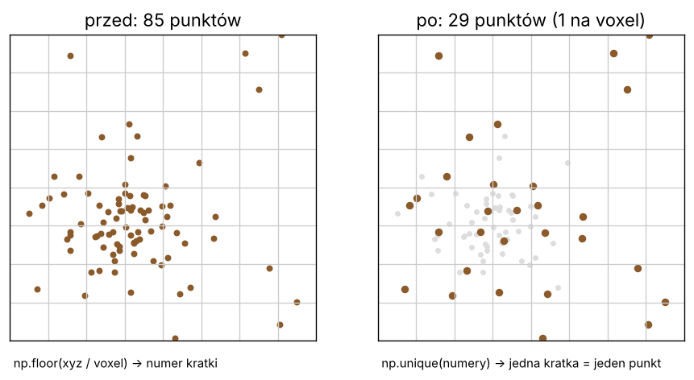

# Lekcja 5 – Przerzedzanie chmury voxelami

**Czego się nauczysz:** czym jest voxel, jak `np.floor` przypisuje punkt do sześcianika,
jak `np.unique` zostawia jeden punkt na sześcianik i jak policzyć środek każdego voxela.
To jeden z najważniejszych trików w całym LidarTreeSegmenter – bez niego 15 mln punktów liczyłoby się
godzinami.

**Pliki:** `cwiczenie_05_voxele.py`, `rozwiazanie_05_voxele.py`

---

## Najpierw po leśnemu

Skaner przy pniu zapisuje tysiące punktów na metr kwadratowy kory, a w koronie mało.
Większość punktów przy pniu mówi to samo – „tu jest kora”. To jak sto osób na
powierzchni próbnej klupujących to samo drzewo: wynik się nie poprawi, a czasu szkoda.

**Przerzedzanie** to jak **trzebież schematyczna**: dzielimy przestrzeń na równe sześcianiki
(np. 5 × 5 × 5 cm) – to są **voxele** (od „volume” + „pixel”, piksel w 3D).
W każdym sześcianiku zostawiamy **jeden** punkt. Gęste miejsca tracą dużo, rzadkie
(czubki, cienkie gałązki) prawie nic. Kształt drzewa zostaje, punktów jest kilka razy mniej.



---

## Krok po kroku

### 1. Numer voxela – `np.floor`

```python
voxel = 0.10                                        # 10 cm
kl = np.floor(punkty / voxel).astype(np.int64)
```

`np.floor` obcina w dół do liczby całkowitej (`floor` = podłoga): 0,37 / 0,10 = 3,7 → **3**.
Punkt (0,37; 0,12; 1,31) dostaje numer voxela (3, 1, 13). Dwa punkty z tym samym trójnumerem
leżą w tym samym sześcianiku.

> Dlaczego `np.floor`, a nie `astype(int)`? Dla liczb ujemnych `astype(int)` obcina **do zera**
> (−3,7 → −3), a `floor` zawsze **w dół** (−3,7 → −4). Współrzędne bywają ujemne.
> W LidarTreeSegmenter odejmuje się dodatkowo najmniejszą współrzędną, żeby numery były ≥ 0.

### 2. Jeden punkt na voxel – `np.unique`

```python
unikalne, pierwszy, ile = np.unique(kl, axis=0, return_index=True, return_counts=True)
```

- `unikalne` – lista różnych voxeli,
- `pierwszy` – numer **pierwszego punktu** w każdym voxelu (te punkty zostawimy),
- `ile` – ile punktów było w każdym voxelu,
- `axis=0` – porównuj całe wiersze (trójki numerów), a nie pojedyncze liczby.

Jest też `return_inverse=True`, które daje odwrotną informację: **dla każdego punktu – do
którego voxela trafił**. Przyda się, gdy wynik policzony dla voxeli trzeba przenieść
z powrotem na wszystkie punkty (LidarTreeSegmenter tak robi z klasyfikacją drewno / liście).

### 3. Trik oszczędzający pamięć – trzy numery w jednej liczbie

```python
klucz = (kl[:, 0] << 42) | (kl[:, 1] << 21) | kl[:, 2]
_, pierwszy = np.unique(klucz, return_index=True)
```

`<< 42` to „przesuń o 42 bity”, czyli pomnóż przez 2⁴². Każdy z trzech numerów dostaje
swoje 21 bitów (do ok. 2 milionów voxeli w każdej osi) i wszystkie mieszczą się w jednej
liczbie. Jak numer działki ewidencyjnej złożony z numeru obrębu, oddziału i wydzielenia.
`np.unique` na jednej kolumnie liczb jest dużo szybszy i lżejszy niż na tablicy N × 3.

### 4. Środek ciężkości voxela – `np.bincount` z wagami

```python
_, pierwszy, odwr = np.unique(klucz, return_index=True, return_inverse=True)
licz = np.bincount(odwr)                                   # punktów w voxelu
srodek_x = np.bincount(odwr, weights=punkty[:, 0]) / licz  # suma x / liczba = średnia x
```

`np.bincount(odwr, weights=x)` dodaje x wszystkich punktów z tego samego voxela.
Podzielone przez liczbę punktów daje średnią – środek ciężkości voxela.

---

## Prawdziwy kod LidarTreeSegmenter – linijka po linijce

**Fragment 1** – `tree_segmenter_tool\02_detect_trees.py`, krok 1. Komentarz autora mówi
wszystko o tym, dlaczego ten trik jest ważny:

```python
        # JEDEN KLUCZ ZAMIAST TRZECH KOLUMN - i to jest roznica miedzy
        # "dziala" a "program zostal zabity".
        ...
        srodek = punkty.min(axis=0)
        kl = np.floor((punkty - srodek) / P.VOXEL_WEJSCIOWY).astype(np.int64)
        if kl.max() >= 2 ** 21:
            # Powierzchnia wieksza niz 21 bitow na os - wracamy do wersji
            # wolniejszej, ale zawsze poprawnej.
            _, pierwszy = np.unique(kl, axis=0, return_index=True)
        else:
            klucz = (kl[:, 0] << 42) | (kl[:, 1] << 21) | kl[:, 2]
            del kl
            _, pierwszy = np.unique(klucz, return_index=True)
            del klucz
        punkty = punkty[np.sort(pierwszy)]
```

| linia | co robi |
|---|---|
| `srodek = punkty.min(axis=0)` | najmniejsze x, y, z – „lewy dolny róg” chmury |
| `kl = np.floor((punkty - srodek) / ...)` | numery voxeli liczone od rogu, więc zawsze ≥ 0 |
| `if kl.max() >= 2 ** 21:` | bezpiecznik: gdy numer nie zmieści się w 21 bitach (obszar ponad ~20 km przy 1 cm), używa wolniejszej, pewnej wersji |
| `np.unique(kl, axis=0, ...)` | wersja „trzy kolumny” |
| `klucz = (...) << 42 | ...` | wersja „jedna liczba” |
| `del kl` | **usuń zmienną** – zwolnij pamięć, zanim zajmiesz następną. Przy 38 mln punktów to setki MB |
| `_` | podkreślnik = „tej wartości nie potrzebuję” (tu: lista unikalnych kluczy) |
| `punkty[np.sort(pierwszy)]` | zostaw po jednym punkcie z voxela; `np.sort` zachowuje pierwotną kolejność punktów |

**Fragment 2** – `program\10_pien_galezie_liscie.py`, krok 3 (cechy geometryczne liczone na
voxelach 2,5 cm, a potem przenoszone na wszystkie punkty):

```python
    kl = np.floor((p - p.min(axis=0)) / P.VOXEL_CECH).astype(np.int64)
    klucz = (kl[:, 0] << 42) | (kl[:, 1] << 21) | kl[:, 2]
    _, pierwszy, odwr = np.unique(klucz, return_index=True, return_inverse=True)
    odwr = odwr.ravel()
    nv = len(pierwszy)
    licz = np.bincount(odwr, minlength=nv).astype(float)
    vox = np.column_stack([np.bincount(odwr, weights=p[:, i], minlength=nv) / licz
                           for i in range(3)])
```

| linia | co robi |
|---|---|
| `return_inverse=True` → `odwr` | dla każdego punktu numer jego voxela |
| `odwr.ravel()` | „spłaszcz” do zwykłej listy (zabezpieczenie na różne wersje numpy) |
| `nv = len(pierwszy)` | liczba voxeli |
| `np.bincount(odwr, minlength=nv)` | ile punktów w każdym voxelu |
| `[... for i in range(3)]` | **lista składana**: zrób to samo dla kolumn 0, 1, 2 (x, y, z) |
| `np.column_stack(...)` | sklej trzy średnie w tablicę voxeli N_vox × 3 |

`P.VOXEL_CECH = 0.025` – komentarz w ustawieniach mówi: *„Bez tego 15 mln punktów
liczyłoby się bardzo długo.”*

---

## Uruchom rozwiązanie

```
python rozwiazanie_05_voxele.py dane_testowe\SKAN_czesci_maly_2_-4.laz
```

```
Punktów w pliku: 1 069 021

Przykład na 5 punktach, voxel 10 cm:
numery voxeli (kolumna, wiersz, piętro):
 [[ 0  0  0]
 [ 0  0  0]
 [ 1  0  0]
 [ 1  0  0]
 [ 5  5 13]]
różnych voxeli: 3  punktów w każdym: [2 2 1]
indeksy punktów, które zostają: [0 2 4]

Ile zostaje punktów przy różnych voxelach:
  voxel  1.0 cm:     890 454 punktów  ( 83.3%)   [1.1 s]
  voxel  2.5 cm:     417 711 punktów  ( 39.1%)   [0.3 s]
  voxel  5.0 cm:     162 279 punktów  ( 15.2%)   [0.2 s]
  voxel 10.0 cm:      49 598 punktów  (  4.6%)   [0.1 s]

Voxel 5 cm: 162 279 voxeli
Najgęstszy voxel ma 129 punktów, średnio 6.6 punktu na voxel
Zapisano: wyniki_kursu\SKAN_czesci_maly_2_-4_voxel_5cm.laz
```

Voxel 5 cm zostawia **15%** punktów. Otwórz zapisany plik w CloudCompare obok oryginału –
drzewo wygląda prawie tak samo. Drugi argument zmienia wielkość voxela:
`python rozwiazanie_05_voxele.py plik.laz 0.02`.

---

## Ćwiczenie

W `cwiczenie_05_voxele.py`:

1. **TODO 1** – policz numery voxeli `kl` (`np.floor`).
2. **TODO 2** – spakuj je w jeden klucz.
3. **TODO 3** – `np.unique(klucz, return_index=True)` i wypisz, ile zostało punktów (i ile %).
4. **TODO 4** – pętla `for` po voxelach 1 cm, 2,5 cm i 10 cm.
5. **TODO 5** – zapisz przerzedzoną chmurę do pliku.

## Podpowiedź

- Procent: `len(pierwszy) / len(punkty) * 100`.
- Pętla: `for voxel in (0.01, 0.025, 0.05, 0.10):` – całe liczenie klucza wcięte pod spodem.
- Przy zapisie użyj `np.sort(pierwszy)`, żeby punkty zostały w pierwotnej kolejności.
- Błąd `OverflowError` albo dziwne wyniki? Sprawdź `.astype(np.int64)` – bez tego przesunięcie
  `<< 42` nie zmieści się w mniejszym typie.

## Podsumowanie

- voxel = sześcianik; `np.floor(punkty / voxel)` daje jego numer,
- `np.unique(..., return_index=True)` – po jednym punkcie z voxela,
- `return_inverse=True` – dla każdego punktu numer voxela (do przenoszenia wyników z powrotem),
- `np.bincount(..., weights=...)` – sumy i średnie w voxelach bez pętli,
- `del zmienna` zwalnia pamięć – ważne przy dużych skanach.
