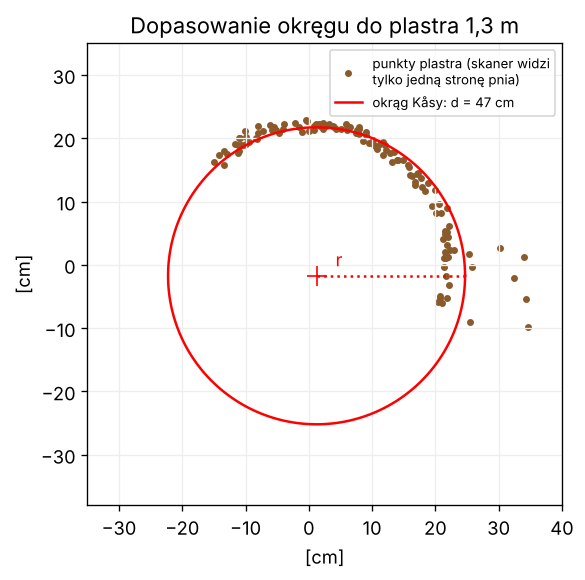
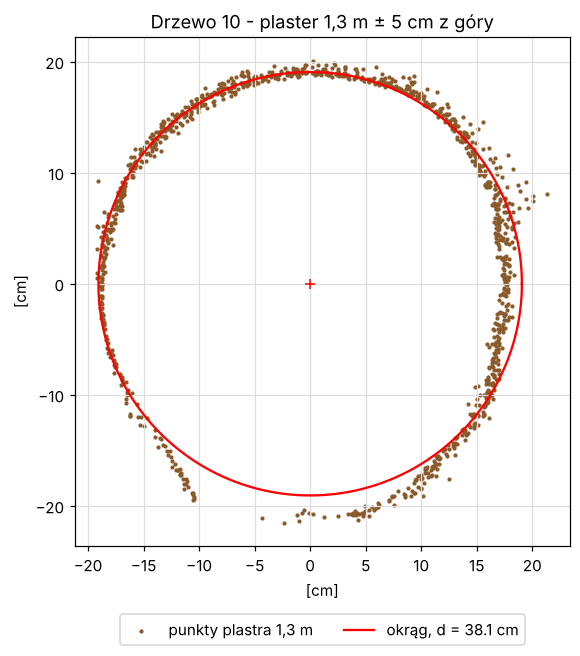

# Lekcja 6 – Pierśnica: okrąg dopasowany do plastra 1,3 m

**Czego się nauczysz:** jak z punktów plastra pierśnicy policzyć środek i promień pnia
metodą najmniejszych kwadratów (metoda **Kåsy**, `np.linalg.lstsq`), dlaczego wynik
bywa zły i jak go sprawdzić. Poznasz też **własny moduł** – plik `kurs_wspolne.py`.

**Pliki:** `cwiczenie_06_okrag.py`, `rozwiazanie_06_okrag.py`, `kurs_wspolne.py`

---

## Najpierw po leśnemu

Klupa mierzy średnicę z dwóch stron pnia. Skaner widzi pień zwykle **tylko z jednej strony** –
w plastrze 1,3 m dostajemy łuk punktów, czasem pół obwodu, czasem mniej. Gdy przyłożysz
do tego łuku **szablon okręgu** i będziesz go przesuwać i powiększać tak, żeby jak najlepiej
pasował do punktów – odczytasz średnicę, choć połowy pnia nie widać.

Komputer robi to samo, tylko matematycznie: szuka okręgu, dla którego punkty leżą
„w sumie najbliżej” – to jest **metoda najmniejszych kwadratów**.



---

## Matematyka – bez strachu

Równanie okręgu o środku (a, b) i promieniu r:

```
(x − a)² + (y − b)² = r²
```

Po wymnożeniu nawiasów i przestawieniu:

```
x² + y² = 2a·x + 2b·y + (r² − a² − b²)
```

Po lewej są rzeczy **znane** (x i y każdego punktu). Po prawej **nieznane** a, b i ta dziwna
reszta – nazwijmy je c₀ = 2a, c₁ = 2b, c₂ = r² − a² − b². Wtedy dla każdego punktu:

```
c₀·x + c₁·y + c₂·1 = x² + y²
```

To jest zwykły układ równań liniowych – taki sam jak przy wyrównywaniu krzywej wysokości.
Punktów jest dużo (setki), niewiadomych tylko trzy, więc równania nie spełnią się dokładnie –
szukamy c, które „najmniej się myli”. W numpy robi to jedno polecenie:

```python
A = np.column_stack([x, y, np.ones_like(x)])   # każdy wiersz: [x, y, 1]
b = x * x + y * y                              # każdy element: x² + y²
c, *_ = np.linalg.lstsq(A, b, rcond=None)      # c = [c0, c1, c2]
```

`lstsq` = *least squares* = najmniejsze kwadraty. Na końcu wracamy do okręgu:

```python
cx, cy = c[0] / 2, c[1] / 2           # a = c0/2,  b = c1/2
r = np.sqrt(c[2] + cx**2 + cy**2)     # r² = c2 + a² + b²
piersnica = 2 * r
```

Nie ma żadnych pętli ani zgadywania – wynik wychodzi od razu, w mikrosekundach.

### Kiedy metoda się myli

Kåsa wierzy **każdemu** punktowi. Jeśli w plastrze są gałązki, odrosty, krzaki podszytu
albo sąsiednie drzewo – okrąg „ucieka” w ich stronę i robi się za duży. Dlatego:

1. **wybieramy punkty pnia** – w pliku `_czesci.laz` LidarTreeSegmenter już je oznaczył (`czesc == 1`),
2. **dopasowujemy odpornie** – liczymy okrąg, wyrzucamy punkty daleko od niego, liczymy znowu
   (funkcja `okrag_odporny` w `kurs_wspolne.py`),
3. **sprawdzamy jakość** – średni błąd dopasowania (jak daleko punkty leżą od okręgu).
   Dobry pień: poniżej 1–2 cm. Kilka–kilkadziesiąt cm – w plastrze jest coś innego niż pień.

LidarTreeSegmenter idzie jeszcze dalej: używa metody **RANSAC** (losuje setki okręgów przez 3 punkty
i wybiera ten, na którym leży najwięcej punktów) i śledzi pień plaster po plastrze od góry,
gdzie nie ma podszytu. Gdy pień na 1,3 m jest zasłonięty – dorysowuje go z wyższych plastrów.

---

## Własny moduł: `kurs_wspolne.py`

Od tej lekcji każdy program musi wczytać chmurę, znaleźć wysokość nad gruntem i wybrać
drzewo. Zamiast kopiować te same 50 linijek do każdego pliku, zebraliśmy je w jednym pliku
`kurs_wspolne.py` – to nasza skrzynka z narzędziami:

```python
import kurs_wspolne as KW                 # "as KW" - krótka nazwa

sciezka = KW.sciezka_z_argumentu()        # sys.argv[1] + sprawdzenie, czy plik istnieje
chm = KW.wczytaj_chmure(sciezka)          # słownik: chm["xyz"], chm["h"], chm["drzewo"], chm["czesc"]
nr, idx = KW.wybierz_drzewo(chm, 17)      # numery punktów drzewa 17 (None = wybierz sam)
```

`chm` to **słownik** (`dict`) – szafka z szufladami podpisanymi nazwami: `chm["xyz"]`
to tablica punktów, `chm["h"]` wysokości nad gruntem. Gdy w pliku czegoś nie ma
(np. surowy skan bez numerów drzew), w szufladzie jest `None`.

Moduł musi leżeć w **tym samym folderze** co lekcja. Otwórz go w edytorze – nie ma tam
nic, czego nie znasz z lekcji 1–5. Tak samo zbudowany jest LidarTreeSegmenter: `lts_uklad.py`,
`lts_gpkg.py`, `lts_teren.py` to jego skrzynki z narzędziami, a główne programy
robią `import lts_uklad as U`.

---

## Prawdziwy kod LidarTreeSegmenter – linijka po linijce

Fragment z `program\10_pien_galezie_liscie.py`, krok 2 (pień):

```python
def okrag_algebraiczny(x, y):
    """Dopasowanie okregu metoda najmniejszych kwadratow (Kasa)."""
    A = np.column_stack([x, y, np.ones_like(x)])
    b = x * x + y * y
    c, *_ = np.linalg.lstsq(A, b, rcond=None)
    cx, cy = c[0] / 2, c[1] / 2
    r2 = c[2] + cx * cx + cy * cy
    return cx, cy, np.sqrt(r2) if r2 > 0 else 0.0
```

| linia | co robi |
|---|---|
| `def okrag_algebraiczny(x, y):` | funkcja dostaje x i y punktów plastra (tablice) |
| `np.ones_like(x)` | tablica jedynek tej samej długości co x – kolumna „· 1” przy c₂ |
| `A = np.column_stack([...])` | macierz N × 3: każdy wiersz `[x, y, 1]` |
| `b = x * x + y * y` | prawa strona: x² + y² dla każdego punktu |
| `c, *_ = np.linalg.lstsq(...)` | rozwiąż metodą najmniejszych kwadratów. `lstsq` zwraca 4 rzeczy; `c, *_` znaczy „pierwszą weź do `c`, resztę wyrzuć” |
| `cx, cy = c[0] / 2, c[1] / 2` | środek okręgu |
| `r2 = c[2] + cx*cx + cy*cy` | promień do kwadratu |
| `return ... if r2 > 0 else 0.0` | oddaj środek i promień; gdy r² wyszło ujemne (zupełnie złe dane) – promień 0. To jest **wyrażenie warunkowe**: `A if warunek else B` |

To dosłownie te same 6 linijek, co w naszym rozwiązaniu. Ten sam wzór, z wyprowadzeniem
w komentarzu, jest w `tree_segmenter_tool\02_detect_trees.py` (funkcja `dopasuj_okrag`).

---

## Uruchom rozwiązanie

Najlepiej na pliku **`_czesci.laz`** (pień jest oznaczony):

```
python rozwiazanie_06_okrag.py ..\..\wyniki\SKAN\02_CHMURY\SKAN_czesci.laz
python rozwiazanie_06_okrag.py ..\..\wyniki\SKAN\02_CHMURY\SKAN_czesci.laz 17
```

Drugi argument to numer drzewa (numery są na obrazkach w `04_OBRAZY_DRZEW` i w raporcie).
Wynik na całym skanie (15 mln punktów, ok. 13 s):

```
Test: sztuczny pień r = 20 cm, widać pół obwodu -> wyszło r = 19.9 cm, środek (5.00, 7.00)
Wczytuję SKAN_czesci.laz ...
  punktów: 15 139 304
  - numer drzewa z pola 'treeID'
  - części drzewa z pola 'czesc'
  - wysokość nad gruntem POLICZONA w przybliżeniu (siatka 1 m)
  nie podano numeru drzewa - wybieram drzewo 10
  biorę tylko punkty oznaczone jako pień (czesc = 1)
Drzewo 10: punktów w plastrze 1,3 m: 1175
Kåsa (wszystkie punkty):   pierśnica = 38.4 cm
Kåsa odporna (bez gałązek): pierśnica = 38.1 cm
Środek pnia: X = -3.69, Y = 12.13
Średni błąd dopasowania: 0.9 cm
Pole przekroju g = 0.1142 m²
LidarTreeSegmenter podaje dla drzewa 10: 37.9 cm
Zapisano obrazek: wyniki_kursu\SKAN_czesci_drzewo_10_okrag.png
```

Nasze 6 linijek dało **38,1 cm**, LidarTreeSegmenter – **37,9 cm**. Obrazek:



**Spróbuj na pliku `_segmenty.laz`** (bez oznaczonego pnia). Dla wielu drzew wyjdzie
pierśnica 2–3 m i komunikat `UWAGA: okrąg pasuje słabo`. W plastrze są wtedy krzaki
podszytu przypisane do drzewa. To nie błąd programu – to najlepsza lekcja tego rozdziału:
**okrąg jest tak dobry, jak punkty, które mu dasz.** Dlatego LidarTreeSegmenter najpierw dzieli drzewo
na pień, gałęzie i liście.

---

## Ćwiczenie

W `cwiczenie_06_okrag.py`:

1. **TODO 1–4** – napisz funkcję `okrag_kasa(x, y)`. Program od razu sprawdza ją na
   sztucznym łuku o promieniu 20 cm – po uzupełnieniu ma wypisać `r = 20.0 cm`.
2. **TODO 5** – wybierz punkty plastra 1,3 m ± 5 cm wybranego drzewa.
3. **TODO 6** – policz pierśnicę i porównaj z raportem LidarTreeSegmenter.

**Dla chętnych:** w `rozwiazanie_06_okrag.py` zmień plaster na ±2 cm i ±15 cm.
Jak zmienia się liczba punktów i pierśnica? (Grubszy plaster = więcej punktów, ale pień
się zbiega i są nabiegi korzeniowe.)

## Podpowiedź

- Wszystkie wzory są w ramce „Matematyka” wyżej; pierwiastek to `np.sqrt(...)`.
- Funkcja ma kończyć się `return cx, cy, r` – Python odda trzy wartości naraz, a wywołanie
  `cx, cy, r = okrag_kasa(...)` rozpakuje je do trzech zmiennych.
- Plaster: `pl = xyz[np.abs(h - 1.3) <= 0.05]`, a potem `okrag_kasa(pl[:, 0], pl[:, 1])`.
- Pierśnica w cm: `2 * r * 100`.

## Podsumowanie

- okrąg Kåsy = układ równań liniowych `A·c = b` rozwiązany przez `np.linalg.lstsq`,
- pierśnica = 2·r, pole przekroju g = π/4 · d²,
- wynik jest dobry tylko wtedy, gdy w plastrze jest sam pień – sprawdzaj błąd dopasowania,
- własny moduł (`import kurs_wspolne as KW`) = kod napisany raz, używany wszędzie.
