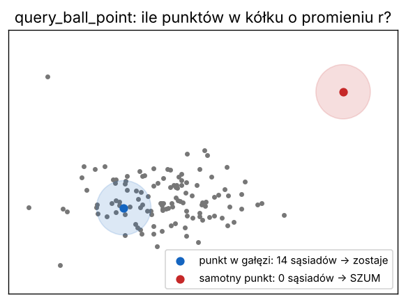

# Lekcja 7 – Sąsiedzi punktu: drzewo KD i usuwanie szumu

**Czego się nauczysz:** jak szybko znaleźć punkty leżące blisko danego punktu
(`scipy.spatial.cKDTree`, `query_ball_point`, `query`), jak policzyć sąsiadów dla
milionów punktów naraz i jak na tej podstawie wyrzucić **szum** – samotne punkty.

**Pliki:** `cwiczenie_07_sasiedzi.py`, `rozwiazanie_07_sasiedzi.py`

---

## Najpierw po leśnemu

Pytanie „które punkty leżą w promieniu 10 cm od tego punktu?” brzmi niewinnie. Ale żeby
odpowiedzieć „na piechotę”, trzeba zmierzyć odległość do **wszystkich** 6 milionów punktów.
A potem zrobić to samo dla każdego z 6 milionów punktów – 36 bilionów pomiarów. Za długo.

**Drzewo KD** to jak dobrze prowadzony **podział powierzchniowy lasu**: nadleśnictwo →
leśnictwo → oddział → pododdział. Szukając drzewa przy konkretnym słupku, nie chodzisz po
całym nadleśnictwie – idziesz od razu do właściwego oddziału i pododdziału. Drzewo KD dzieli
chmurę na pół, potem każdą połowę znowu na pół, i tak dalej. Pytanie o sąsiadów sprawdza
tylko kilka najbliższych „pododdziałów”.

**Szum** to punkty-duchy: odbicia od kurzu, owadów, krawędzi, deszczu. Mają jedną cechę:
**są samotne**. Prawdziwy punkt kory czy gałązki ma wokół siebie innych sąsiadów.



---

## Polecenia

```python
from scipy.spatial import cKDTree

kd = cKDTree(pkt)                           # budowa "podziału" – raz, kilka sekund

blisko = kd.query_ball_point(srodek, r=1.0)  # numery punktów w promieniu 1 m od jednego punktu
odl, nr = kd.query(srodek, k=3)             # 3 najbliższe punkty: odległości i numery

# dla WSZYSTKICH punktów naraz – sama liczba sąsiadów (oszczędza pamięć):
ile = kd.query_ball_point(pkt, r=0.10, return_length=True, workers=-1)
ile = ile - 1                               # bez samego siebie (punkt jest swoim sąsiadem)
szum = ile < 5                              # maska samotnych punktów
```

- `return_length=True` – nie oddawaj list numerów (zajęłyby gigabajty), tylko **ile** ich jest,
- `workers=-1` – użyj wszystkich rdzeni procesora,
- `k=9` w `query` – dziewięciu najbliższych sąsiadów (pierwszy to sam punkt, odległość 0).

### Dwie metody szukania szumu

1. **Promień** – ile sąsiadów w kółku o promieniu r. Mniej niż próg → szum.
2. **SOR** (*Statistical Outlier Removal*) – średnia odległość do k najbliższych sąsiadów.
   Gdy jest dużo większa niż u typowego punktu (średnia + 2 odchylenia standardowe) → szum.

Obie mówią to samo innymi słowami: „prawdziwe punkty mają bliskich sąsiadów”.

### Pułapka

Czubki drzew i cienkie gałązki też mają mało sąsiadów! Za ostry filtr zje wierzchołki
i **wysokości drzew wyjdą za małe**. Dlatego program wypisuje średnią wysokość
punktów uznanych za szum – jeśli jest dużo większa niż średnia wszystkich punktów,
filtr tnie korony.

---

## Prawdziwy kod LidarTreeSegmenter – linijka po linijce

**Fragment 1** – `tree_segmenter_tool\02_detect_trees.py`, krok 2 (usuwanie szumu SOR):

```python
    drzewo_kd = cKDTree(punkty)
    PARTIA = 2_000_000
    srednie_odlegosci = np.empty(len(punkty), dtype=np.float32)
    for poczatek in range(0, len(punkty), PARTIA):
        koniec = min(poczatek + PARTIA, len(punkty))
        odl, _ = drzewo_kd.query(punkty[poczatek:koniec],
                                 k=P.SOR_SASIEDZI + 1, workers=-1)
        srednie_odlegosci[poczatek:koniec] = odl[:, 1:].mean(axis=1)
        del odl
    ...
    prog = srednie_odlegosci.mean() + P.SOR_PROG_ODCHYLEN * srednie_odlegosci.std()
    zostaw = srednie_odlegosci < prog
```

| linia | co robi |
|---|---|
| `drzewo_kd = cKDTree(punkty)` | zbuduj drzewo KD z całej chmury |
| `PARTIA = 2_000_000` | podkreślniki w liczbie tylko dla czytelności: 2 000 000 |
| `np.empty(..., dtype=np.float32)` | zarezerwuj miejsce na wynik (float32 – połowa pamięci float64) |
| `for poczatek in range(0, len(punkty), PARTIA):` | pętla co 2 mln: 0, 2 000 000, 4 000 000 … |
| `koniec = min(...)` | ostatnia partia może być krótsza |
| `drzewo_kd.query(..., k=P.SOR_SASIEDZI + 1, ...)` | k najbliższych (+1, bo pierwszy to sam punkt) |
| `odl[:, 1:].mean(axis=1)` | pomiń kolumnę 0 (odległość do siebie = 0), średnia w każdym wierszu |
| `del odl` | zwolnij pamięć przed następną partią |
| `prog = średnia + N · odchylenie` | próg odcięcia: „nienormalnie daleko od sąsiadów” |
| `zostaw = srednie_odlegosci < prog` | maska punktów, które zostają |

Autor zostawił w kodzie ważną uwagę: przy 20 mln punktów zapytanie o całą chmurę naraz
tworzy tablicę odpowiedzi na kilka gigabajtów i system zabija program. **Partiami zużycie
pamięci jest stałe, a wynik dokładnie ten sam.** Nasze rozwiązanie robi tak samo.

**Fragment 2** – ten sam plik, śledzenie pnia: punkty w kole o promieniu 60 cm wokół
przewidywanej osi pnia, a potem tylko te z bieżącego plastra wysokości:

```python
            w_kole = np.asarray(kd_pelne.query_ball_point((kx, ky), 0.6),
                                dtype=np.int64)
            if len(w_kole) < 12:
                continue
            w_kole = w_kole[
                (wys_pelny[w_kole] >= h_tu - P.SLEDZENIE_KROK / 2) &
                (wys_pelny[w_kole] < h_tu + P.SLEDZENIE_KROK / 2)]
```

| linia | co robi |
|---|---|
| `kd_pelne.query_ball_point((kx, ky), 0.6)` | numery punktów w promieniu 0,6 m od (kx, ky). Drzewo KD jest tu zbudowane na samych **x, y** – więc „koło” to w praktyce pionowy walec |
| `if len(w_kole) < 12: continue` | za mało punktów → `continue` = „pomiń resztę i przejdź do następnego obrotu pętli” |
| `w_kole[(wys >= ...) & (wys < ...)]` | maska z lekcji 2: zostaw tylko punkty z plastra o grubości `SLEDZENIE_KROK` |

---

## Uruchom rozwiązanie

```
python rozwiazanie_07_sasiedzi.py ..\..\wyniki\SKAN\02_CHMURY\SKAN_segmenty.laz
python rozwiazanie_07_sasiedzi.py plik.laz 0.05 3      (promień 5 cm, min. 3 sąsiadów)
```

Wynik na całym skanie (15 mln punktów; ok. 1 minuty, 1,6 GB pamięci):

```
Po przerzedzeniu do 3 cm: 6 015 052 punktów
Drzewo KD zbudowane w 3.1 s

W promieniu 1 m od środka chmury (-0.9, 1.7, 1.1) jest 29865 punktów
Trzy najbliższe punkty są w odległości: [3.7 4.2 4.3] cm

Sąsiedzi w promieniu 10 cm policzeni w 17.4 s
  mediana: 35 sąsiadów, najwięcej: 173
  szum (mniej niż 5 sąsiadów): 39 982 punktów = 0.66%

SOR (8 sąsiadów, próg średnia + 2 sigma = 7.0 cm): 229044 punktów szumu [10.1 s]
Obie metody zgodne co do 96.9% punktów
Średnia wysokość szumu: 5.5 m, wszystkich punktów: 5.0 m

Zapisano: wyniki_kursu\SKAN_segmenty_sasiedzi.laz
```

Najpierw przerzedzamy do 3 cm (lekcja 5) – inaczej przy pniach każdy punkt miałby setki
sąsiadów i liczyłoby się kilka razy dłużej. Otwórz zapisany plik w CloudCompare i pokoloruj
punkty po polu `sasiedzi` (*Edit → Scalar fields → Set active*) – gęste pnie świecą, korona
jest ciemniejsza, a szum to pojedyncze kropki w powietrzu.

Tu też uczymy się **dopisywać własne pola** do pliku `.laz`:

```python
nag.add_extra_dim(laspy.ExtraBytesParams(name="sasiedzi", type=np.uint16))
...
las.sasiedzi = ile
```

---

## Ćwiczenie

W `cwiczenie_07_sasiedzi.py`:

1. **TODO 1** – zbuduj drzewo KD.
2. **TODO 2** – policz punkty w promieniu 1 m od środka chmury.
3. **TODO 3** – policz sąsiadów każdego punktu w promieniu 10 cm.
4. **TODO 4** – maska szumu (mniej niż 5 sąsiadów); ile to punktów i procent?
5. **TODO 5 (dla chętnych)** – zmień promień na 5 i na 20 cm. Co się dzieje i dlaczego?

## Podpowiedź

- Wszystkie polecenia są w ramce „Polecenia” wyżej.
- Ćwicz na małym pliku z `dane_testowe` – liczy się w kilka sekund.
- Procent: `szum.mean() * 100` (True = 1, False = 0, więc średnia to ułamek True).
- Przy mniejszym promieniu prawie każdy punkt ma mało sąsiadów → „szum” rośnie;
  przy większym nawet zabłąkane punkty znajdą sąsiadów → „szum” maleje.

## Podsumowanie

- `cKDTree(pkt)` – „podział powierzchniowy” chmury, buduje się raz,
- `query_ball_point(p, r)` – punkty w promieniu r; `query(p, k)` – k najbliższych,
- `return_length=True` i liczenie **partiami** – sposób na miliony punktów bez braku pamięci,
- szum = punkty z małą liczbą sąsiadów; uważaj na czubki drzew.
