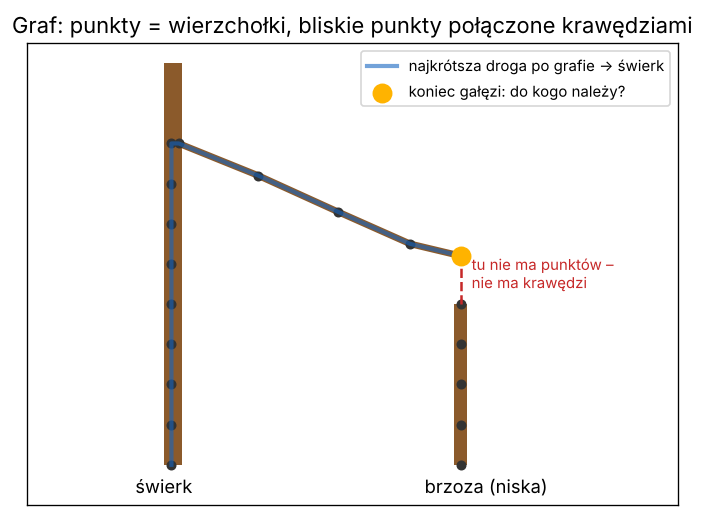
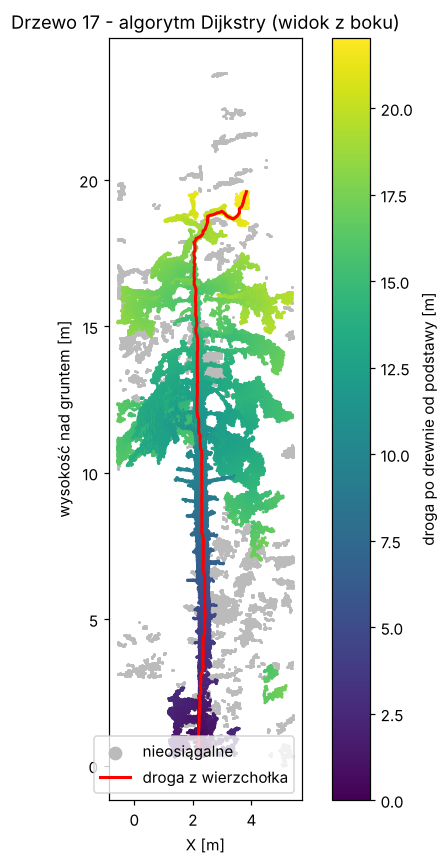

# Lekcja 8 – Graf i algorytm Dijkstry: droga „po drewnie”

**Czego się nauczysz:** czym jest **graf**, jak zbudować go z chmury punktów (każdy voxel
łączymy z najbliższymi sąsiadami), jak algorytmem **Dijkstry** (`scipy.sparse.csgraph.dijkstra`)
policzyć najkrótszą drogę od podstawy pnia do każdego punktu i jak odtworzyć tę drogę
od wierzchołka drzewa w dół.

**Pliki:** `cwiczenie_08_graf.py`, `rozwiazanie_08_graf.py`

---

## Najpierw po leśnemu

Gałąź wysokiego świerka przewiesza się 15 m nad ziemią dokładnie nad niską brzozą.
Gdy zapytasz „który pień jest **najbliżej w linii prostej**?” – wyjdzie brzoza. Brzoza
„urośnie” do 20 m i wysokość w raporcie będzie bzdurna.

Zapytajmy inaczej – jak w kodzie LidarTreeSegmenter:

> „Gdybym był **wiewiórką** i musiał zejść **po drewnie** do najbliższego pnia,
> **do którego pnia** bym doszedł?”

Z końca gałęzi świerka droga po drewnie prowadzi wzdłuż gałęzi do jego pnia – kilka metrów.
Do brzozy trzeba by skoczyć przez **puste powietrze** – a tam nie ma po czym iść.
Więc gałąź zostaje przy świerku.



**Graf** to sieć: **wierzchołki** (u nas voxele) połączone **krawędziami** (u nas: dwa voxele
leżą blisko siebie). Każda krawędź ma **wagę** – długość w metrach. Jak sieć dróg leśnych:
skrzyżowania to wierzchołki, odcinki dróg to krawędzie, a waga to długość odcinka.

**Algorytm Dijkstry** to ten sam algorytm, który liczy trasę w nawigacji samochodowej:
zaczyna od startu i „rozlewa się” po sieci jak woda, zawsze najpierw tam, gdzie najbliżej,
zapisując dla każdego wierzchołka najkrótszą drogę i **skąd przyszedł** (poprzednika).

---

## Krok po kroku

### 1. Voxele (lekcja 5)

Przerzedzamy drzewo do voxeli 5 cm – graf z kilkudziesięciu tysięcy wierzchołków liczy się
w sekundę, z miliona punktów – znacznie dłużej.

### 2. Krawędzie: każdy voxel z 10 najbliższymi (lekcja 7)

```python
odl, sas = cKDTree(srodki).query(srodki, k=11)
odl, sas = odl[:, 1:], sas[:, 1:]                    # bez samego siebie
zrodlo = np.repeat(np.arange(nv), 10)                # 0,0,...,0, 1,1,...,1, ...
cel = sas.ravel()                                    # numery sąsiadów jedną kolumną
waga = odl.ravel()                                   # odległości jedną kolumną
ok = waga <= 0.15                                    # bez skoków dłuższych niż 15 cm
```

Krawędź to trójka (skąd, dokąd, ile metrów). Wyrzucamy dłuższe niż 15 cm –
to właśnie „nie skacz przez powietrze”.

### 3. Graf jako macierz rzadka

```python
from scipy.sparse import coo_matrix
graf = coo_matrix((waga[ok], (zrodlo[ok], cel[ok])), shape=(nv, nv)).tocsr()
```

Graf można zapisać jako wielką tabelę nv × nv: w wierszu i, kolumnie j – długość krawędzi
z i do j. Prawie wszystkie pola są puste (voxel ma tylko 10 sąsiadów, a nie 50 000),
więc **macierz rzadka** zapisuje tylko niepuste pola. `coo_matrix((wartości, (wiersze, kolumny)))`
buduje ją z naszych trzech kolumn, `.tocsr()` zamienia na postać szybką do liczenia.

### 4. Dijkstra

```python
from scipy.sparse.csgraph import dijkstra
droga, poprzednik, skad = dijkstra(graf, directed=False, indices=starty,
                                   return_predecessors=True, min_only=True)
```

- `indices=starty` – numery voxeli startowych (najniższe voxele pnia),
- `directed=False` – po krawędzi można iść w obie strony,
- `min_only=True` – liczymy od **wszystkich startów naraz** i dla każdego voxela zostaje
  najbliższy start (bez tego scipy liczyłoby osobną tabelę dla każdego startu),
- `droga[i]` – długość najkrótszej drogi do voxela i (`inf` = nie da się dojść),
- `poprzednik[i]` – z którego voxela się do niego przyszło (`-9999` = to jest start),
- `skad[i]` – z którego startu.

### 5. Odtworzenie trasy

```python
trasa = [szczyt]
while poprzednik[trasa[-1]] >= 0:      # dopóki nie doszliśmy do startu
    trasa.append(poprzednik[trasa[-1]])
```

Pętla `while` – „powtarzaj, **dopóki** warunek jest prawdziwy”. Idziemy od wierzchołka
drzewa krok po kroku do poprzednika, aż do podstawy pnia – jak po śladach na śniegu.

---

## Prawdziwy kod LidarTreeSegmenter – linijka po linijce

Fragment z `tree_segmenter_tool\02_detect_trees.py`, krok 6b (segmentacja grafowa – który
punkt należy do którego drzewa):

```python
    kd = cKDTree(srodki)
    k = min(P.GRAF_SASIEDZI + 1, n_voxeli)
    odl, sas = kd.query(srodki, k=k, workers=-1)

    # odrzucamy kolumne 0 (voxel sam ze soba) i krawedzie za dlugie
    odl, sas = odl[:, 1:], sas[:, 1:]
    zrodlo = np.repeat(np.arange(n_voxeli), odl.shape[1])
    cel = sas.ravel()
    odleglosc_rzeczywista = odl.ravel()

    ok = odleglosc_rzeczywista <= P.GRAF_MAX_DLUGOSC_KRAWEDZI
    zrodlo, cel = zrodlo[ok], cel[ok]

    roznica = srodki[cel] - srodki[zrodlo]
    waga = np.sqrt(P.GRAF_KARA_POZIOMA * (roznica[:, 0] ** 2 + roznica[:, 1] ** 2)
                   + roznica[:, 2] ** 2)
    waga = np.maximum(waga, 0.001)

    graf = coo_matrix((waga, (zrodlo, cel)),
                      shape=(n_voxeli, n_voxeli)).tocsr()
    ...
    _, _, zrodla = dijkstra(graf, directed=False, indices=starty,
                            return_predecessors=True, min_only=True)
```

| linia | co robi |
|---|---|
| `k = min(P.GRAF_SASIEDZI + 1, n_voxeli)` | ilu sąsiadów szukać (nie więcej niż jest voxeli) |
| `odl[:, 1:], sas[:, 1:]` | wyrzuć kolumnę 0 – voxel sam ze sobą |
| `np.repeat(np.arange(n), m)` | numer voxela powtórzony tyle razy, ilu ma sąsiadów → kolumna „skąd” |
| `sas.ravel()` | tablicę sąsiadów „spłaszcz” do jednej kolumny → „dokąd” |
| `ok = ... <= P.GRAF_MAX_DLUGOSC_KRAWEDZI` | krawędź istnieje tylko, gdy voxele są naprawdę blisko |
| `roznica = srodki[cel] - srodki[zrodlo]` | wektor każdej krawędzi (dx, dy, dz) |
| `waga = np.sqrt(KARA · (dx² + dy²) + dz²)` | **sprytny dodatek**: ruch w poziomie „kosztuje” więcej niż w pionie. Wiewiórka woli iść po pniu w górę/dół niż skakać w bok po liściach sąsiada |
| `np.maximum(waga, 0.001)` | Dijkstra nie lubi krawędzi o długości 0 – minimum 1 mm |
| `coo_matrix(...).tocsr()` | graf jako macierz rzadka |
| `_, _, zrodla = dijkstra(...)` | potrzebny jest tylko trzeci wynik: **z którego startu** (którego pnia) przyszła najkrótsza droga. To jest przypisanie voxela do drzewa |

Autor w komentarzu odróżnia dwie rzeczy: *„czy można przejść” to geometria (długość
krawędzi), „ile to kosztuje” to nasza decyzja (waga z karą)*. Warto to zapamiętać.

---

## Uruchom rozwiązanie

```
python rozwiazanie_08_graf.py ..\..\wyniki\SKAN\02_CHMURY\SKAN_czesci.laz 17
```

W pliku `_czesci.laz` program pomija podszyt i startuje od najniższych voxeli **pnia**.
Wynik (wycinek 6 × 6 m, drzewo 17):

```
Drzewo 17: 175 850 punktów
Voxeli 5 cm: 47 724
Krawędzi (połączeń) w grafie: 470 530
Voxeli startowych (najniższe 30 cm drzewa): 138
Dijkstra dotarła do 75.5% voxeli (reszta jest odcięta - dziura w skanie albo obcy fragment)

Wierzchołek: 19.6 m nad gruntem
Droga po drewnie od podstawy do wierzchołka: 22.0 m (367 voxeli)
Stosunek drogi do wysokości: 1.14  (blisko 1 = prosty pień)
Wierzchołek jest przesunięty w poziomie o 2.92 m od podstawy
Zapisano obrazek: wyniki_kursu\..._drzewo_17_dijkstra.png
```



Popatrz na obrazek: kolor rośnie równo wzdłuż pnia, a gałęzie mają kolor „pnia, z którego
wyrastają, plus długość gałęzi”. Czerwona trasa z wierzchołka **sama znalazła pień** –
schodzi po nim do ziemi. Tak można „śledzić pień od ziemi w górę”.

Szare punkty są **nieosiągalne** – nie ma do nich drogi krótszymi skokami niż 15 cm.
To zwykle kawałki korony nad dziurą w skanie (zasłonięty fragment pnia) albo gałęzie
sąsiada. LidarTreeSegmenter nie wyrzuca ich po cichu – przypisuje je do najbliższego osiągniętego
voxela i raportuje, ile ich było. Komentarz w kodzie wyjaśnia dlaczego: kiedyś trzy
najwyższe drzewa straciły przez to czubki i miały wysokość zaniżoną o 3–8 m.

---

## Ćwiczenie

W `cwiczenie_08_graf.py`:

1. **TODO 1 – rozgrzewka:** mały graf z 5 wierzchołków (narysowany w komentarzu).
   Policz drogę z 0 do 3. Prosto jest 4,0 – a naokoło przez 1, 2, 4?
2. **TODO 2** – znajdź 10 sąsiadów każdego voxela drzewa.
3. **TODO 3** – zbuduj graf (bez kolumny 0 i bez krawędzi > 0,15 m).
4. **TODO 4** – start = najniższe voxele; policz Dijkstrę.
5. **TODO 5** – porównaj drogę do najwyższego voxela z jego wysokością.

## Podpowiedź

- Rozgrzewka: `droga = dijkstra(graf, directed=False, indices=0)`, potem `print(droga)`.
  Odpowiedź: do punktu 3 jest **4,0** – a naokoło 1 + 1 + 1 + 1 = 4,0. Remis! Zmień wagę
  krawędzi 0–3 na 5,0 i zobacz, że Dijkstra wybierze objazd.
- Krawędzie drzewa: przepisz punkty 2 i 3 z ramki „Krok po kroku”.
- Najwyższy osiągnięty voxel: `i = np.flatnonzero(np.isfinite(droga))`,
  `szczyt = i[np.argmax(vox[i, 2])]`.

## Podsumowanie

- graf = wierzchołki + krawędzie z wagami; z chmury: voxele + połączenia z najbliższymi,
- macierz rzadka `coo_matrix(...).tocsr()` – zapis grafu bez marnowania pamięci,
- `dijkstra(..., indices=starty, min_only=True, return_predecessors=True)` – najkrótsze drogi
  od wielu startów naraz i poprzednicy do odtworzenia trasy,
- „najbliżej po drewnie” zamiast „najbliżej w linii prostej” – na tym opiera się podział
  chmury na drzewa w LidarTreeSegmenter.
