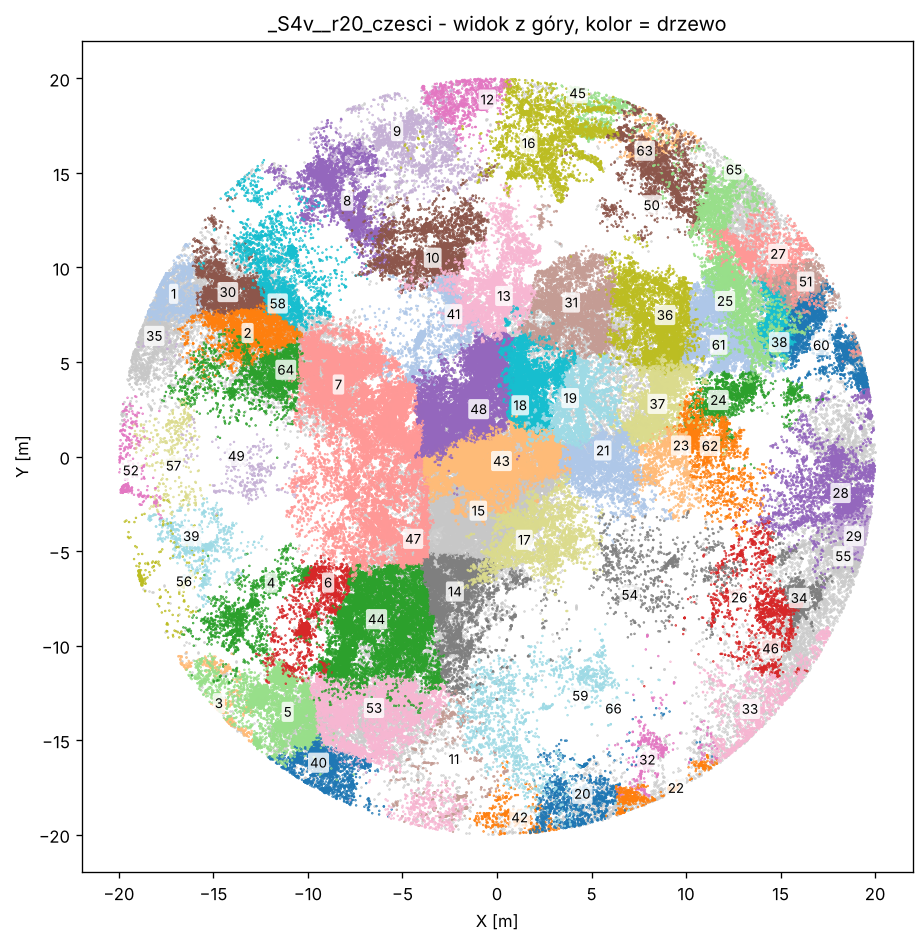
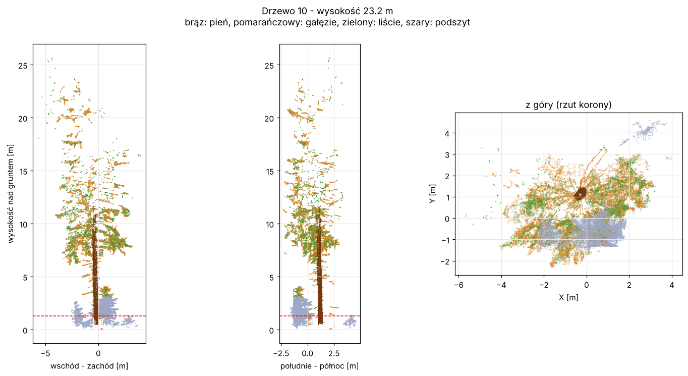

# Lekcja 10 – matplotlib: mapa skanu i karta drzewa

**Czego się nauczysz:** jak narysować chmurę punktów z góry i z boku (`scatter`),
pokolorować punkty według drzewa, wysokości albo części drzewa, dodać linię 1,3 m,
podpisy i tytuły, zapisać obrazek PNG i pokazać go w okienku. I dlaczego przy 15 mln
punktów **losujemy próbkę**.

**Pliki:** `cwiczenie_10_obrazki.py`, `rozwiazanie_10_obrazki.py`

---

## Najpierw po leśnemu

Liczby z raportu to jedno, ale taksator chce **zobaczyć** drzewo. Obrazek to jak
**szkic z opisu taksacyjnego**: rzut korony z góry i profil z boku. Od razu widać,
czy pień jest prosty, gdzie zaczyna się korona i czy program nie przypisał drzewu
krzaka z podszytu.

LidarTreeSegmenter rysuje taką kartę dla każdego drzewa (folder `04_OBRAZY_DRZEW`). Zrobimy podobną.

---

## Podstawy matplotlib

```python
import matplotlib.pyplot as plt

fig, ax = plt.subplots(figsize=(8, 8))      # kartka (fig) i jeden wykres na niej (ax)
ax.scatter(x, y, s=0.5, c=h, cmap="viridis")   # punkty: s = wielkość, c = kolor
ax.set_aspect("equal")                      # 1 m w poziomie = 1 m w pionie (inaczej drzewo się "rozciągnie")
ax.set_xlabel("X [m]")
ax.set_ylabel("Y [m]")
ax.set_title("Widok z góry")
ax.axhline(1.3, color="red", ls="--")       # pozioma linia na 1,3 m
fig.savefig("obrazek.png", dpi=120, bbox_inches="tight")   # zapis do pliku
plt.show()                                  # okienko z obrazkiem (na Windows)
```

- **Najpierw `savefig`, potem `show`.** Po zamknięciu okienka wykres jest „zużyty”
  i zapisałby się pusty.
- Kilka wykresów obok siebie: `fig, (ax1, ax2, ax3) = plt.subplots(1, 3, figsize=(16, 7))`.
- Kolor może być: jedną nazwą (`"red"`, `"#8b5a2b"`), kolumną liczb + paleta (`c=h, cmap="viridis"`)
  albo tablicą kolorów RGB, po jednym na punkt (tak kolorujemy części drzewa).
- `fig.colorbar(sc, ax=ax, label="...")` – pasek z legendą kolorów.

### Dlaczego losujemy próbkę

Narysowanie 15 mln punktów trwa minutami, a obrazek i tak ma ok. 1 mln pikseli – większość
punktów nałożyłaby się na siebie. Losujemy więc 150–300 tysięcy:

```python
rng = np.random.default_rng(0)                       # generator losowy (0 = zawsze ta sama próbka)
los = rng.choice(len(xyz), 300_000, replace=False)   # 300 tys. różnych numerów punktów
ax.scatter(xyz[los, 0], xyz[los, 1], s=0.2)
```

### Kolejność rysowania

Punkt narysowany później przykrywa wcześniejszy. Chcemy, żeby pień był widoczny na tle
gałęzi, więc sortujemy punkty tak, by pień był **na końcu**:

```python
kolej = np.argsort(czesc == 1, kind="stable")    # False (nie pień) najpierw, True (pień) na końcu
```

`np.argsort` daje numery w kolejności od najmniejszej wartości – a `False` < `True`.

---

## Prawdziwy kod LidarTreeSegmenter – linijka po linijce

Fragment z `program\10_pien_galezie_liscie.py`, funkcja `podglad` – karta każdego drzewa:

```python
    kolory = np.array([[.7, .7, .7], [.45, .22, .05], [.85, .55, .2],
                       [.2, .6, .2], [.62, .66, .78]])
    ...
        m = wsz
        if len(m) > 150_000:                    # do rysowania wystarczy probka
            m = rng.choice(m, 150_000, replace=False)
        m = m[np.argsort(czesc[m] == PIEN, kind="stable")]   # pien na wierzchu
        ...
            ax.scatter(xyz[m, i] - srodek, h[m], s=0.3, c=kolory[czesc[m]],
                       linewidths=0, rasterized=True)
            ...
            ax.axhline(1.3, color="#d62728", lw=1, ls="--")
            ax.text(ax.get_xlim()[0], 1.3, " 1,3 m", color="#d62728",
                    va="bottom", fontsize=8)
            ax.set_aspect("equal")
        ...
        fig.savefig(kat / f"drzewo_{t:0{cyfry}d}.png", dpi=100,
                    bbox_inches="tight")
        plt.close(fig)
```

| linia | co robi |
|---|---|
| `kolory = np.array([[.7, .7, .7], ...])` | 5 kolorów RGB (czerwony, zielony, niebieski od 0 do 1): szary = nic, brąz = pień, pomarańcz = gałęzie, zielony = liście, szaroniebieski = podszyt |
| `rng.choice(m, 150_000, replace=False)` | próbka 150 tys. punktów drzewa |
| `m[np.argsort(czesc[m] == PIEN, ...)]` | pień na końcu, czyli na wierzchu |
| `c=kolory[czesc[m]]` | **sprytne**: `czesc` to numery 0–4, więc `kolory[czesc]` od razu daje kolor dla każdego punktu (indeksowanie tablicą – jak odczyt z tabeli) |
| `xyz[m, i] - srodek` | odległość od osi pnia (i = 0 dla wschód–zachód, 1 dla północ–południe) |
| `linewidths=0, rasterized=True` | bez obwódek punktów; punkty zapisane jako obraz – lżejszy plik |
| `ax.axhline(1.3, ...)`, `ax.text(...)` | czerwona przerywana linia pierśnicy z podpisem „1,3 m” |
| `f"drzewo_{t:0{cyfry}d}.png"` | nazwa z numerem uzupełnionym zerami: `drzewo_007.png` – pliki ładnie się sortują |
| `plt.close(fig)` | zamknij kartkę – przy setkach drzew bez tego zabrakłoby pamięci |

Na samej górze funkcji jest `matplotlib.use("Agg")` – LidarTreeSegmenter rysuje obrazki „w tle”,
bez okienek, prosto do plików. My chcemy okienko, więc tego nie robimy.

---

## Uruchom rozwiązanie

```
python rozwiazanie_10_obrazki.py ..\..\wyniki\SKAN\02_CHMURY\SKAN_czesci.laz
python rozwiazanie_10_obrazki.py ..\..\wyniki\SKAN\02_CHMURY\SKAN_czesci.laz 10
```

Program zapisze dwa obrazki do `wyniki_kursu` i otworzy dwa okienka (zamknij je, żeby
zakończyć program). W okienku jest pasek narzędzi: lupa – przybliżanie, krzyżyk –
przesuwanie, dyskietka – zapis.

**Mapa skanu** – każde drzewo innym kolorem, numer w miejscu pnia:



Widać, że skan jest **kołem** o promieniu 20 m – stąd uwaga o polu powierzchni w lekcji 9.

**Karta drzewa** – dwa widoki z boku i rzut z góry, kolory części:



Na karcie od razu widać problem z lekcji 6: przy ziemi wokół pnia jest dużo **podszytu**
(szaroniebieski), który leży w plastrze 1,3 m. Bez oznaczenia części okrąg by się pomylił.

Na surowym skanie (bez numerów drzew) mapa jest kolorowana wysokością, a karta pokazuje
okolicę najgęstszego miejsca w plastrze 1,3 m.

---

## Ćwiczenie

W `cwiczenie_10_obrazki.py`:

1. **TODO 1** – widok z boku: `ax1.scatter(p[:, 0], h, ...)`.
2. **TODO 2** – czerwona przerywana linia na 1,3 m.
3. **TODO 3** – widok z góry na `ax2`.
4. **TODO 4** – równe skale osi i podpisy.
5. **TODO 5** – zapis PNG **przed** `plt.show()`.

**Dla chętnych:**

- dodaj trzeci wykres: plaster 1,3 m z góry, w centymetrach, z okręgiem z lekcji 6
  (`from kurs_wspolne import okrag_odporny`),
- pokoloruj punkty według `p_drewno` (trzeba je wczytać z pliku przez laspy – lekcja 3).

## Podpowiedź

- `ax.set_aspect("equal")` dla obu wykresów, inaczej drzewo wygląda jak patyk albo jak beczka.
- `s=0.3` – małe punkty; przy dużych (`s=5`) korona zleje się w plamę.
- Okienko się nie pojawia? Sprawdź, czy na końcu jest `plt.show()`. W VS Code okienko może
  otworzyć się **pod** edytorem – zobacz pasek zadań.
- Polskie znaki w tytułach działają od razu (domyślna czcionka DejaVu Sans je ma).

## Podsumowanie

- `fig, ax = plt.subplots(...)`, `ax.scatter(x, y, s=..., c=...)`, `ax.set_aspect("equal")`,
- przy milionach punktów rysuj **losową próbkę** (`rng.choice`),
- kolory części: `kolory[czesc]`; pień na wierzchu: `np.argsort(czesc == 1)`,
- `fig.savefig(...)` przed `plt.show()`; przy wielu obrazkach `plt.close(fig)`.

---

## Co dalej?

Przeszedłeś całą drogę, którą przechodzi skan w LidarTreeSegmenter:

```
plik .laz  →  numpy (lekcja 2–3)  →  grunt i wysokość (4)  →  voxele (5)
           →  sąsiedzi, szum (7)  →  graf, podział na drzewa (8)
           →  pień i pierśnica (6)  →  tabela, miąższość, Excel (9)  →  obrazki (10)
```

Teraz możesz otworzyć prawdziwe programy LidarTreeSegmenter w folderze `program` i czytać je
fragment po fragmencie – rozpoznasz w nich każdy klocek z tego kursu. Zacznij od
`40_widok_3d.py` (najkrótszy), potem `30_raport.py`, na końcu `10_pien_galezie_liscie.py`.
